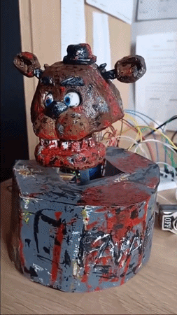

# fnaf-animatronic-head
My first Arduino project, created entirely on my own in 2022, along with my first test repository on GitHub.

# FNAF Animatronic Head - Freddy Fazbear

Projekt mechatronicznej animatronicznej głowy inspirowanej postacią Freddy'ego Fazbeara z gry *Five Nights at Freddy's*. Projekt oparty na mikroprocesorze Arduino UNO, sterujący serwomechanizmami oraz silnikiem krokowym.

## 🛠️ Podzespoły i Architektura

* **Mikrokontroler:** Arduino UNO
* **Sterownik silników:** Adafruit Motor Shield v2 (komunikacja I2C)
* **Napęd obrotu głowy:** Silnik krokowy 28BYJ-48 (5V)
* **Mechanika twarzy:** 4x Serwo PWM (Oczy, Szczęka, Lewe Ucho, Prawe Ucho), Dioda LED
* **Interfejs użytkownika:** 2x Przycisk (Start, Tryb)

## 🔌 Tabela Połączeń (Hardware Layout)

| Element | Podłączenie | Opis |
| :--- | :--- | :--- |
| **Adafruit Motor Shield v2** | Wpięta w Arduino | Komunikacja I2C (SDA/SCL) |
| **Silnik krokowy 28BYJ-48** | Port M3/M4 na Shieldzie | Obrót głowy |
| **Serwo Oczy** | Pin D4 | Sterowanie oczami |
| **Serwo Ucho P** | Pin D5 | Prawe ucho |
| **Serwo Szczęka** | Pin D6 | Otwieranie pyska |
| **Serwo Ucho L** | Pin D7 | Lewe ucho |
| **Przycisk START** | Pin D8 | Wyzwalanie losowej sekwencji |
| **Przycisk TRYB** | Pin D9 | Przełącznik trybu Normal/Agresywny |
| **Dioda LED** | Pin D2 | Podświetlenie oczu i pyska w trybie agresywnym |

## 🚀 Wymagane Biblioteki

Do poprawnej kompilacji projektu w Arduino IDE wymagane są biblioteki:
* `Servo.h` (wbudowana w Arduino IDE)
* `Adafruit_MotorShield.h` (Adafruit Motor Shield V2 Library)

## 🎮 Funkcjonalność

Robot posiada dwa główne tryby pracy:
1. **Tryb Normalny (Przycisk TRYB = LOW):** Wolne, stonowane ruchy uszu, ruchy gałek ocznych i mowy.
2. **Tryb Agresywny (Przycisk TRYB = HIGH + LED ON):** Szybkie, gwałtowne ruchy sekwencyjne imitujące zachowanie animatronika w trybie ataku.
